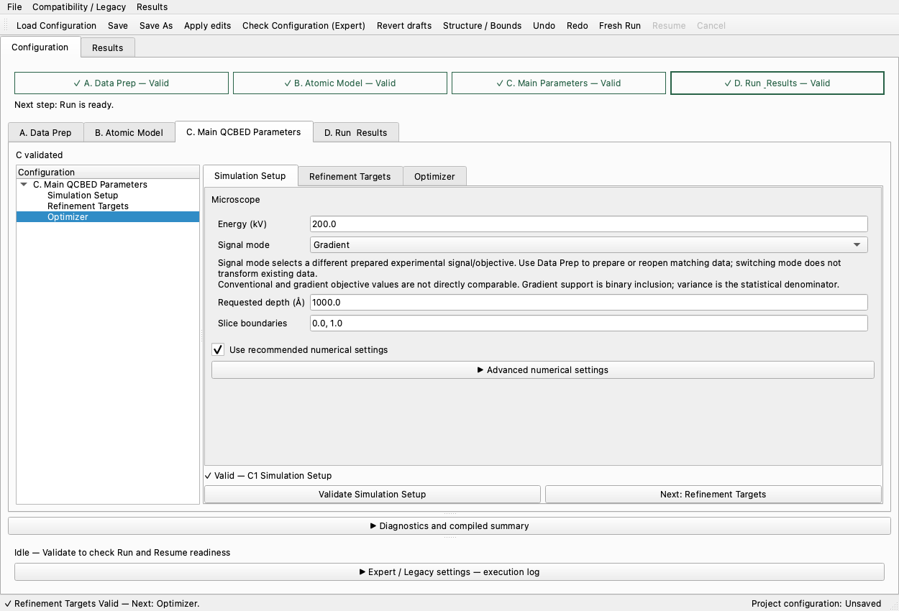
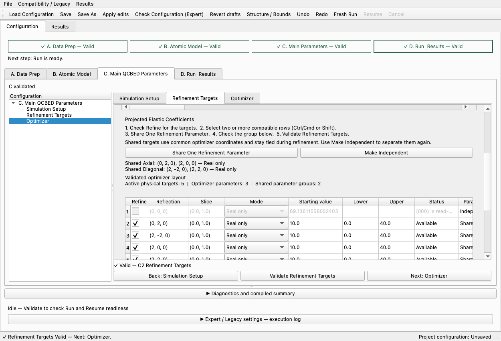
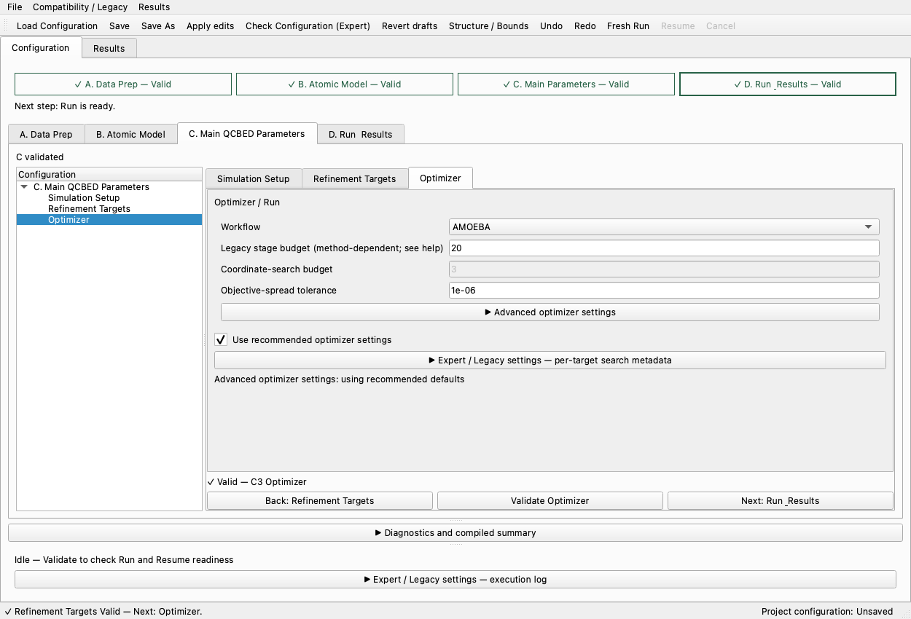

# C-tab layout and sharing guidance

The previous frozen app reproduced constrained/clipped content and excessive text
in Refinement Targets. A literal button-on-button overlap was not reproduced.
Source-widget geometry isolated a sizing defect: C reparented section bodies while
their original QScrollArea still owned them. The coefficient panel stayed 602 px
wide at window widths 937, 1250 and 1700. Detaching each body with `takeWidget()`
before moving it fixes that ownership; the panel now grows with its viewport.

C content scrolls independently of the bottom status/Back/Validate/Next area.
Action rows switch to vertical stacking when their labels cannot fit horizontally.
Tables retain internal scrolling; expanding details cannot cover the bottom actions.
No fixed larger window size is used as a workaround.

The visible hierarchy is:

- Simulation Setup: physical inputs and recommended numerics; numerical details
  are under Advanced.
- Refinement Targets: physical-target table, coefficient table, visible sharing
  steps, immediate group/mode summary and compact draft/validated counts.
- Optimizer: workflow, recommended settings and budget/convergence controls;
  search metadata and other technical settings remain expandable.

IAM/components/Friedel details, the mode-specific sharing example, full group
bounds and the resolved optimizer layout are collapsed by default. The sharing
instructions explicitly distinguish checking Refine from selecting rows. The
example explains Real-only 2 → 1 coordinates (3 → 2 with depth); Complex shares
two coordinates, and Magnitude-only preserves each member's fixed phase.
Mandatory Friedel constraints remain separate from optional user sharing.

The geometry regression uses actual Qt widgets, repeated regeneration, sharing,
validation and narrow/normal/wide windows. The frozen smoke exercises real A/B/C
setup and actual Share/Make Independent buttons before checking all three pages
at 960×720, 1250×850 and 1700×950, including expanded/collapsed panels.

Physics, parameter mapping, validation rules and persistence semantics are unchanged.
See the current release/validation records for exact results and package provenance.

Final focused regression: **46 passed**, 96 Qt deprecation warnings, 43.09 seconds.
A strengthened geometry follow-up also passed both tests (5.70 seconds).
Frozen resized GUI smoke: **PASS**, zero optimizer evaluations. The coefficient
panel measured 596 / 886 / 1336 px at the three tested window widths. The initial
smoke hook was corrected to run after B/C setup; the final frozen process exited
successfully. No full-suite rerun was requested for this layout-only pass; the
preceding milestone's 3,025-pass suite remains historical baseline evidence.

