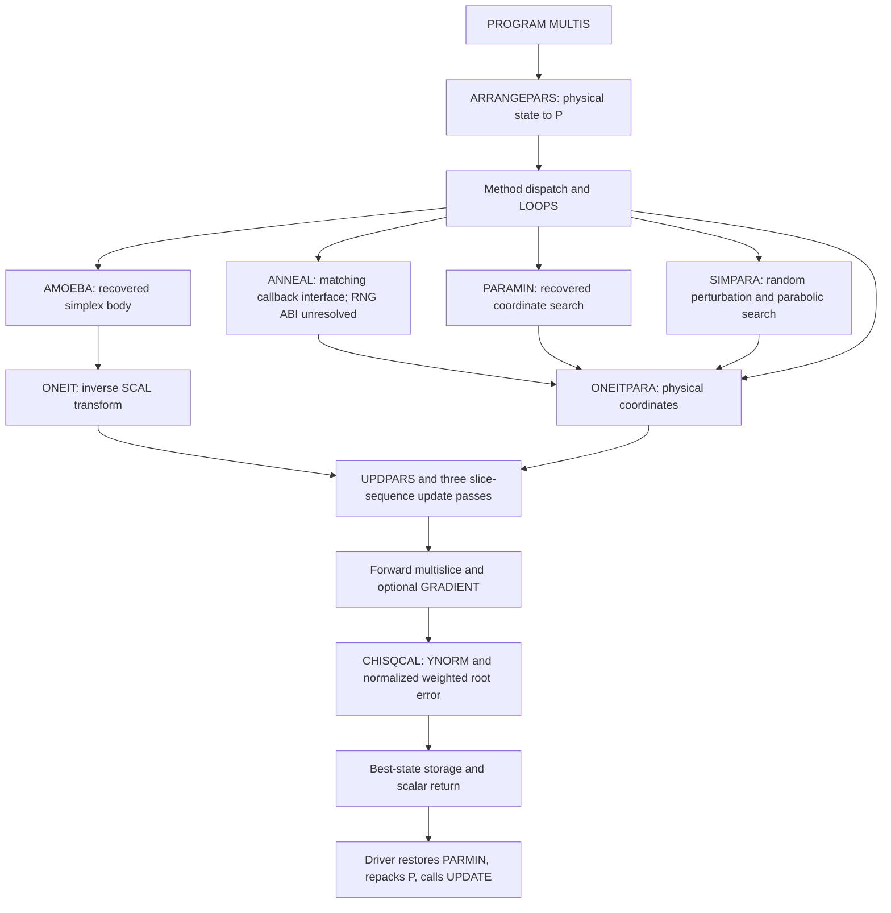

# Legacy refinement architecture audit

> Clean-import provenance update: the [canonical source inventory](legacy_source_inventory.md)
> supersedes source-location, binary-only, duplicate and missing-provider claims below.
> Driver: private predecessor implementation; ONEIT: private predecessor implementation; ONEITPARA: private predecessor implementation; optimizers now
> occupy their matching .f files; RNG: private predecessor implementation; ATOMICSCATFACT:
> private predecessor implementation (all tables confirmed). The four recently corrected core
> file bodies are unchanged. Historical test results below remain historical.


## Evidence and limits

The source-derived multi-stage driver is now implemented as
`run_legacy_refinement`, with `parse_legacy_refinement` and immutable controls,
results and history. See [refinement driver](refinement_driver.md) for tested
METHOD/LOOPS orchestration, coordinate transitions and retained-state rules.
This does not establish historical executable equivalence.

This is a static audit, not an optimizer implementation or executable-equivalence
claim. Readable executable statements take precedence over names and comments;
call sites and real inputs corroborate them. private predecessor implementation is only the
[related-version declaration reference](source_provenance.md). No fixed legacy
capacity or exact COMMON layout should become a Python design constraint.

| File and lines | Actual readable role |
| --- | --- |
| private predecessor implementation| PROGRAM MULTIS: input, method dispatch, repetitions, output |
| private predecessor implementation| scan masks, IREF, structure-factor masks, method/control/vector records |
| private predecessor implementation| optimizer sequencing and final parameter output |
| private predecessor implementation| ARRANGEPARS: pack active physical parameters |
| private predecessor implementation| ONEIT: scaled-coordinate objective callback |
| private predecessor implementation| CHISQCAL: shared objective |
| private predecessor implementation| UPDPARS: unpack parameters and update derived physical state |
| private predecessor implementation| ONEITPARA: physical-coordinate objective callback |
| private predecessor implementation| Replacement COMMON-based ANNEAL; driver signature matches, RNG ABI and capacity compatibility unresolved |
| private predecessor implementation| SIMPARA: stochastic simultaneous parabolic optimizer |
| private predecessor implementation| separate gas-atom randomization in SFMAP |

The restored private predecessor implementation is readable. private predecessor implementation, private predecessor implementation,
private predecessor implementation, private predecessor implementation, private predecessor implementation and private predecessor implementation begin with ELF magic, not Fortran
text. The readable AMOEBA definition is in private predecessor implementationprivate predecessor implementation defines
ONEIT instead. private predecessor implementation contains FFT source; private predecessor implementation contains ATOMICSCATFACT.
No readable RANDNUMGEN, RANDO, NRANDO or URANDO definition was found.
ELF symbol tables do define rando_, nrando_ and urando_ in private predecessor implementation and
private predecessor implementation; symbol presence does not establish their argument/return kinds.
The supplied Makefile is also an ELF artifact, so it cannot establish the
historical build/link selection. Binary symbols or filenames do not recover
algorithm bodies. References below are relative to private predecessor sources unless noted.

## Call graph and routine roles



Arrows out of unavailable optimizers mean **callbacks passed by the driver**,
not an audited internal invocation count or policy. PROGRAM MULTIS drives the
workflow; ONEITPARA is not a top-level driver or parallel scheduler.
UPDPARS and ARRANGEPARS perform mapping; UPDATE is an unavailable utility whose
side effects cannot be reconstructed. CHISQCAL is a scalar objective utility.

## Driver inputs, sequencing and restarts

private predecessor implementationreads METHOD, PARAOPT, LOUD; LOOPS; MAXFSIMP; MAXFPARA;
FTOL; CHIMIN; MAXTEMP; MINTEMP; COOLRATE, in that order. MINCH=CHIMIN.
ARRANGEPARS determines NPAR before reading NPAR PLAMDA values and NPAR pairs
D1,D2. SPAR copies PLAMDA into UNCERTAINTIES. No random starting P is generated
here. Method matching tests the first four characters in all-upper or all-lower
case explicitly, not arbitrary case folding.

Each selected branch repeats the following ordered calls R=1..LOOPS:

| METHOD | Calls in each repetition | Branch / call lines |
| --- | --- | --- |
| ANNE | ANNEAL | 533-581 / 549 |
| SPAR | SIMPARA | 583-634 / 602 |
| PAAN | PARAMIN then ANNEAL | 636-739 / 666,707 |
| ANPA | ANNEAL then PARAMIN | 741-844 / 766,812 |
| SIMP | AMOEBA | 846-929 / 894-895 |
| PARA | PARAMIN | 931-993 / 959 |
| SIPA | AMOEBA then PARAMIN | 996-1133 / 1052-1053,1099 |
| PASI | PARAMIN then AMOEBA | 1136-1275 / 1170,1239-1240 |
| SIAN | AMOEBA then ANNEAL | 1278-1410 / 1329-1330,1376 |
| ANSI | ANNEAL then AMOEBA | 1413-1547 / 1441,1510-1511 |

Each stage resets CHISMIN=1E20 and evaluates ONEITPARA(P) before searching;
after searching it calls UPDPARS(PARMIN), ARRANGEPARS and UPDATE. This carries
the best physical parameters into the next stage/repetition and rebuilds the
simplex when required. It is **not proven random-restart initialization**.
Best-so-far is reset per stage, not monotonically retained as one scalar for
the entire run. SFMAP2/output calls surround these transitions.

LOOPS<=0 takes the single-evaluation branch (1548-1560). Final output restores
PARMIN and writes NFUNCEVAL, PARMIN, YNORMBEST, CHISMIN (1564-1569). There is no
unconditional final local polish, global-then-local pipeline, or fallback for
an unrecognized positive-LOOPS METHOD. Internal restarts of unavailable
optimizers are unknown.

## Replacement ANNEAL: narrow interface, RNG and capacity audit

**Classification: interface-compatible but dependency/ABI compatibility
unresolved for historical execution.** The explicitly float64 Python
source-derived algorithm is now implemented; see [ANNEAL optimizer](anneal_optimizer.md)
for its full audit, seeded RNG, capacity guard and tests. This does not resolve
the historical ABI conclusions recorded below.

### Content discovery and evidence scope

Artifact extensions are unreliable. Inspecting files beyond `.f` found:

| Path | Actual content relevant to compatibility |
| --- | --- |
| private predecessor implementation| Readable REAL*8 URANDO, NRANDO and RANDO definitions |
| private predecessor implementation| Readable PARAMIN declarations and RANDO call |
| private predecessor implementation| Readable AMOEBA signature and array dimensions |
| private predecessor implementation| Readable ANNEAL, byte-identical to current private predecessor implementation |
| private predecessor implementation | Readable include, byte-identical to supplied private predecessor implementation |
| private predecessor implementation / private predecessor implementation | Readable UPDATE / GRADIENT, not compiled objects |

These are **text source discoveries, not machine-code reverse engineering**.
Earlier statements elsewhere in this document about absent RNG definitions
or unavailable PARAMIN/AMOEBA bodies reflected the `.f` inventory and are
superseded by this content inventory. Their algorithms are not re-audited in
this narrowly scoped update. A text `.o` is not proof of what was linked.
The RNG header describes single precision, but its explicit REAL*8 definitions
are stronger evidence. Source content takes priority over comments/extensions.

Current private predecessor implementation SHA256 is
`7905B6D659D2B7EDA135FFBD737C042C5FF6154C2A34DB099102045A9EFD3B51`, also matching
private predecessor implementation. That is positive same-tree evidence, not historical build proof.
The previous module-based replacement's symbols and conclusions do not apply.

### Driver and callback interface

private predecessor implementationdefines ANNEAL(GOF,MAXITS). GOF is REAL*8 and EXTERNAL (7,11);
MAXITS is INTEGER*8 (6). All five current calls are
ANNEAL(ONEITPARA,MAXFSIMP): private predecessor implementation(ANNE),707 (PAAN),766 (ANPA),
1376 (SIAN),1441 (ANSI). Argument number, order and roles agree.
ONEITPARA is REAL*8/external in the driver (30,35), with REAL*8 PT(1000)
in private predecessor implementation. MAXFSIMP is INTEGER*8 in the shared include. This last
kind/layout evidence is for the supplied related-version include, not a
certification of the historical executable.

There are no module dependencies or explicit RNG INTERFACE blocks. All relevant
caller RNG declarations are EXTERNAL type declarations: they state expected
return type, not checked dummy-argument kinds. private predecessor implementation does not declare
RANDO/NRANDO/URANDO or override these local declarations. Its shared P/PARMIN
REAL*8 types do not prevent REAL(...) conversion to default real in ANNEAL.

ANNEAL calls UPDPARS at 16,42,88,97; ARRANGEPARS at 17,43,89,98; and GOF at
21,47,93,102. GOF is the driver's ONEITPARA, which reaches CHISQCAL at
private predecessor implementationand returns CSQ at 250. Its physical-vector representation
matches the pack/unpack routines. No direct ONEIT call, PBEST/chibest state,
qcbedms_var, utils_mod or cmp_ftol remains in this version.

### Complete readable RNG type inventory

Here `default REAL` deliberately does **not** mean a proven byte size.
REAL*8 denotes the explicit eight-byte legacy declaration. DBLE of a result
does not repair a wrong external return declaration.

| Caller and line(s) | Routine / return expected by caller | Actual arguments in order |
| --- | --- | --- |
| private predecessor implementationidentical private predecessor implementation | NRANDO, default REAL | 3: INTEGER*8 SEED; default REAL from REAL(PARMIN(M)); default REAL from REAL(PARMIN(M)*TEMP(M)) |
| same declarations | RANDO, default REAL | no call in these routines |
| private predecessor implementation(SIMPARA) | RANDO, REAL*8 | 1: INTEGER*8 SEED |
| private predecessor implementation| NRANDO, REAL*8 | 3: INTEGER*8 SEED; default-real literal 0.0; REAL*8 PERTSIZE(J) |
| private predecessor implementation| URANDO, REAL*8 | declared only, no call |
| private predecessor implementation(SFMAP) | RANDO, REAL*8 | 1: INTEGER*8 KER |
| private predecessor implementation(PARAMIN) | RANDO, default REAL | 1: INTEGER*8 SEED; return wrapped in DBLE |
| private predecessor implementation(URANDO) | RANDO, REAL*8 | 1: INTEGER*8 local SEED |
| private predecessor implementation(NRANDO) | RANDO, REAL*8 | 1: INTEGER*8 local SEED, two textual call sites |

The definitions in private predecessor implementation specify:

- URANDO(GRAIN,CENTRAL,SIG), lines 13-24: REAL*8 return; INTEGER*8 GRAIN;
  REAL*8 CENTRAL,SIG.
- NRANDO(GRAIN,CENTRAL,SIG), lines 26-50: same argument/return kinds.
- RANDO(POW), lines 52-77: REAL*8 return; INTEGER*8 POW.

No other readable RNG call sites were found across the content-classified
`.f` and `.o` files. No URANDO call was found. PARAMIN's binary-named `.f`
references NRANDO too, but that does not establish a readable argument list
or reconcile it with the text PARAMIN in private predecessor implementation.

RANDO also depends on timing helpers (private predecessor implementation): TIME() has no arguments
and is declared INTEGER*8; ETIME(ET) and DTIME(DT) have default-REAL returns
and one default-REAL length-two array argument, with EXTERNAL declarations.
Their compiler/runtime implementations and interfaces are not supplied as
readable source. This is an additional runtime-kind contract, not a new RNG
or proof that the surrounding compiler used any particular defaults.

### Build and binary metadata evidence

Repository file inventory and precision-option searches included text,
artifact bytes, hidden project files outside .git, and supplied reference
scripts/docs. No recorded -r8, -real-size 64, -fdefault-real-8,
-freal-4-real-8, /autodouble, -autodouble, -xtypemap, -dbl, /real_size,
FFLAGS/FCFLAGS or equivalent documented default-real promotion was found.
The file named Makefile is ELF, not build instructions. No usable compiler
project/batch configuration was found. An archived predecessor scheduler script loaded
an Intel module and runs executables; it does not compile them or specify
precision options. The padqcbed log contains Intel-runtime-style errors from
distcorr, which cannot establish qcbedms precision settings.

Safe ELF64 section/symbol-table inspection of private predecessor sources artifacts found
rando_, nrando_, urando_ defined as function symbols in private predecessor implementation and private predecessor implementation,
with symbol sizes 480,1184,512 bytes respectively. These sizes describe code,
not return values or arguments. private predecessor implementation has undefined rando_/nrando_ symbols;
private predecessor implementation has undefined nrando_; private predecessor implementation/private predecessor implementation have undefined rando_.
No debug-type or recorded-command-line sections were present in the inspected
ELF artifacts. private predecessor implementation has a .comment string identifying GCC 8.3.1 (Red Hat),
which neither records Fortran default-kind flags nor binds the artifact to
this source. No machine instructions were decoded and no artifact was run.

Therefore readable RNG source signatures are now known, but matching those
signatures to the supplied compiled definitions and historical caller options
is **not proven**. Default REAL=8 is **not established**. The same symbol names
and code sizes are insufficient evidence for a return/argument ABI contract.

### Conditional mixed-kind risk

Under a compiler/build where default REAL is four bytes and REAL*8 is eight:

- ANNEAL expects a four-byte NRANDO result while the readable implementation
  returns eight bytes. The caller may interpret the wrong width/format of the
  return register or return storage. DBLE then promotes the misinterpreted
  value; it is not a cross-procedure conversion of the real eight-byte result.
- Both ANNEAL center and scale actuals are four-byte temporaries while the
  readable NRANDO expects eight-byte values. With normal by-reference Fortran
  calling, the callee reads the wrong width through each address, potentially
  consuming adjacent bytes and producing arbitrary values/nonfinite results.
- SIMPARA's NRANDO result and scale match REAL*8, but its literal 0.0 center
  is still default REAL: that argument has the same conditional mismatch.
- PARAMIN's default-REAL RANDO return conflicts with the readable REAL*8 return;
  its INTEGER*8 seed matches. SFMAP and internal RNG-to-RNG calls match the
  visible REAL*8 and INTEGER*8 signatures.

The exact stack/register effect depends on compiler/target ABI. A pointee-kind
mismatch need not move argument pointer slots, and two real return kinds may
use the same register with different widths. It remains unsafe either way;
no particular crash or numerical error is guaranteed. Wrong center, scale or
return interpretation can corrupt random proposal values. Uniform default-real
promotion could reconcile the listed real mismatches, but must be demonstrated
for caller and callee and checked against runtime helpers, not assumed.

### Active-parameter count and capacity audit

NPAR is the actual packed active count (private predecessor implementation), reset to zero
and incremented for selected masks. ANNEAL loops over that count; MAXITS and
other optimizer iteration counters do not cap it. CHISMIN is a REAL*8 scalar
fit value, not a parameter array or count. UPDPARS' COUNT comparison at
private predecessor implementationonly reports mapping-count disagreement, not overflow.

| Storage / routine | Visible capacity and count contract |
| --- | --- |
| ANNEAL, private predecessor implementation| TEMPVAR,TEMP,TEMPTEMP each 1000; indexes 1..NPAR |
| Shared include, private predecessor implementation| PARAMNUM=2000; P,PARMIN and associated bounds/scales sized from it; NPAR INTEGER*8; CHISMIN scalar in CHISQ |
| ONEIT/ONEITPARA/UPDPARS | PT(1000), and ONEIT STOREPT(1000) |
| PARAMIN, private predecessor implementation| TEMPVAR,BOT,TOP,PARAMORDER,PARAMSWITCH each 1000; shared NPAR |
| SIMPARA, private predecessor implementation| parameter/work arrays 2000; NPARAM receives driver NPAR |
| AMOEBA, private predecessor implementation| NMAX=2000 work vectors; P(MP,NP),Y(MP); NDIM active count and MPTS=NDIM+1 |
| Driver, private predecessor implementationand repeated simplex branches | SIMP(2001,2000),YP(2000); passes MP=1001,NP=1000,NDIM=NPAR |

The include capacities are exact for the supplied declaration file, not
verified historical limits. private predecessor implementation is byte-identical to that file, which
corroborates present-tree content but not original provenance.

No explicit NPAR<=1000 guard was found in the driver, ARRANGEPARS, mapping,
ANNEAL or the readable optimizer declarations/control checks. NPAR>1000
indexes past ANNEAL's local arrays and also exceeds several callback/PARAMIN
arrays. NPAR>2000 exceeds the supplied shared arrays during packing itself.
The driver writes P(NPAR+1) on simplex paths, so filling every shared slot
also makes that extra write unsafe. The reference FOR007.DAT and
STARTINGFOR007.DAT have 18 active parameters; FOR0013.DAT:989,3652 confirms 18.
Those examples fit the limits but neither enforce safety nor test ANNEAL.

For fixed input sizes, let R=NREGIONS, T=NTYPE, A=sum_s NBALL(s), and
F=sum_r NRF(r). From the packing statements, the all-active upper envelope is

```text
NPAR <= 8 + 3*R + 3*T + R*T + 2*A + 2*F
```

The eight comprise energy, dilation and six scan coordinates; regions supply
one depth plus at most two vacancy coefficients; absorption supplies three
per species; DW supplies one per region/species; atoms supply two positions;
reflections supply two factors. Absorption/record/mask choices can reduce this.
This is a combinatorial envelope, not a validated allocation bound: readable
input-dependent loops do not enforce a universal active-count maximum.
Even using only the related include's R=1000,T=10,SL=2500,ATOMS=10,NUMHKL=50
would give an illustrative envelope 163038, far beyond 2000; this does not
claim such an input could safely run. More simply, 501 selected region depths
plus 501 selected DW values already require 1002 slots. Current fixtures alone
cannot exclude such overflows.

The newly found AMOEBA dummy dimensions make the driver concern concrete:
passing SIMP(2001,2000) as P(1001,1000) gives a different column stride for
multiple columns under ordinary Fortran storage association. It is not cured
by NPAR<=1000. Driver literals 1001/1000 are default integers whereas dummy
MP/NP are INTEGER*8; default-integer promotion/build settings are also unknown.
These are existing compatibility issues, not a reason to redesign optimizers
in this task. No Python array should copy these fixed capacities.

### Version conclusion and next evidence needed

The signature, callbacks, COMMON names, pack/unpack path and exact duplicate
in private predecessor implementation support the current source architecture. There is no evidence
requiring the classification 'likely from a different source version'. Under
default REAL=4, however, the caller contracts conflict with the newly found
REAL*8 RNG source. Since actual build kinds/link selection remain unknown,
the classification is **interface-compatible but dependency/ABI compatibility
unresolved**, not strongly compatible or unconditionally incompatible.

Next obtain original compiler commands/default-kind settings and establish
which RNG definitions were linked, including timing-helper contracts. Confirm
the intended active-count domain and address capacity/leading-dimension issues
as explicit follow-up decisions. The source signatures no longer need to be
recovered: they are readable in private predecessor implementation. With explicit authorization to use
float64 and a deterministic Python RNG, the algorithm audit and implementation
have now proceeded independently of historical ABI recovery. The source uses
greedy Gaussian proposals with ties, not Metropolis acceptance; details are in
[ANNEAL optimizer](anneal_optimizer.md).

Narrow-audit validation: **1357 tests passed in 37.57 s**, using exactly
`C:\Users\peng863\AppData\Local\miniconda3\envs\qcbed-python\python.exe`.
This is Python regression validation, not an RNG ABI test. The requested
`git diff --cached --check` passed with no staged changes. Final status still
lists this document and the user's already replaced private predecessor implementation; its SHA256
remained unchanged. Nothing was staged or committed. Earlier validation notes
outside this section describe the preceding audit, not this run.

## AMOEBA: source-derived simplex implementation

The complete readable body is recovered in `private predecessor implementation`.
`run_legacy_amoeba` now translates this modified Numerical Recipes Nelder-Mead
algorithm in float64, with `build_legacy_simplex` mirroring the driver.
See [AMOEBA optimizer](amoeba_optimizer.md) for exact source ranges, ranking,
coefficients, branch rules, coordinate mapping, stopping and validation.

All five driver calls use ONEIT with legacy-simplex coordinates. Reflection,
expansion, contraction and shrink coefficients are 1, 2, 0.5 and 0.5.
Expansion is compared against the old best, not reflection. NUMF excludes
initial simplex evaluations and its limit is checked with strict `>` only at
loop heads. FTOL controls relative objective spread; CHIMIN separately tests
the mean of best and worst. There is no final best-vertex swap.

The callback's retained best can differ from the final simplex best; both
are exposed explicitly. The driver restores PARMIN through UPDPARS,
ARRANGEPARS and UPDATE after return. Python does not implement that multi-stage
driver inside AMOEBA or mutate the baseline refinement state. The separate
[refinement driver](refinement_driver.md) now orchestrates the stages.

The recovered P(MP,NP) declaration confirms the leading-dimension mismatch:
driver SIMP(2001,2000) is passed with MP=1001,NP=1000. Python uses dynamic
(N+1,N) arrays and guards the ONEIT-supported 1..1000 parameter domain; it does
not reproduce unsafe historical memory interpretation. Executable equivalence
remains unverified. ANNEAL does not call AMOEBA.

## PARAMIN: source-derived coordinate parabolic optimizer

The complete readable body in `private predecessor implementation` is now translated by
`run_legacy_paramin`. See [PARAMIN optimizer](paramin_optimizer.md) for the
literal interpolation, branch rules, range adaptation, counters and tests.
All five driver calls pass LOW=D2, HIGH=D1 and ONEITPARA, so the active vector
is physical and the ranges are relative factors, not absolute bounds.

PARAMIN visits one active coordinate at a time, in packed order or a random
order produced by duplicate rejection. Each visit evaluates two relative
samples and a parabolic/fallback point. Callback bookkeeping accepts ties;
local BEST updates are strict improvements. Each cycle ends with a retained
point reevaluation and CHISMIN reset. Stopping uses mean old relative range
and the inclusive MAXFPARA cycle test, not objective convergence or MINCH.
There is no call to AMOEBA or another optimizer within PARAMIN.

Python uses dynamic arrays with an explicit 1..1000 active-count guard,
float64 arithmetic and private seeded PCG64 for optional random traversal.
Historical clock-based RANDO ABI and executable equivalence remain unresolved.
The existing driver sequencing table remains applicable and is now implemented
by the separate [refinement driver](refinement_driver.md).

## SIMPARA: implemented source-derived stochastic optimizer

`run_legacy_simpara` now implements this path in float64. See
[SIMPARA optimizer](simpara_optimizer.md) for the complete audit, approved
zero-initialized startup policy, callback aliasing, RNG choices and tests.
Historical executable equivalence remains unverified.

The sole call is private predecessor implementationin SPAR:

```text
SIMPARA(ONEITPARA,MAXFSIMP,MAXTEMP,MINTEMP,COOLRATE,
        UNCERTAINTIES,P,PARMIN,NPAR,PARAOPT,NFUNCEVAL,LOUD,13)
```

private predecessor implementationdefines the arguments as GOF, MAXITS, HITEMP, LOTEMP,
COOLING, UNCERT, INVAR, OUTVAR, NPARAM, POPT, NFUNC, VERB, OUNIT. This is a
serial optimizer operating on the active physical vector, not a simulation
wrapper, parameter mapper or parallel execution path.

Executable behavior:

- 73-104: initialize SEED=0, counters, CURRENTTEMP=HITEMP, OUTVAR=INVAR,
  PERTSIZE=temperature*absolute UNCERT; evaluate C0=GOF(OUTVAR), set CBEST,
  copy CENTRAL. Continue while TOTSTEPS<=MAXITS and temperature>=LOTEMP*COOLING.
- 125-145: POPT=1 draws a permutation by repeated RANDO(SEED) selection with
  duplicate rejection; POPT=0 uses listed order. Other values leave the order
  unspecified. Python uses explicit seeded uniforms; historical clock-dependent
  seed mutation is not reproduced.
- 169-225: construct perturbations using NRANDO(SEED,0.0,PERTSIZE). The comments
  call this normal random noise; readable private predecessor implementationsupplies the polar
  transform reused by the Python implementation. Improvement selects
  signs aligned with OUTVAR-CENTRAL. Other cycles alternate direction rules,
  including a rejection loop until an absolute sign-direction dot product is
  <=1.50. UNITVEC is approximately a sign vector, not a Euclidean unit vector;
  “orthogonal” comments do not establish an exactly zero dot product.
- 223-278: evaluate CENTRAL-PERTVEC and CENTRAL+PERTVEC. Fit a parabola for
  each coordinate using the same three total objective values C0,C1,C2.
  Positive curvature proposes -BB/(2*AA); other cases use a signed half-step.
  Evaluate the combined NEWVAR only if at least one parabola qualified;
  otherwise C3=1E20. This is not a sequence of independent coordinate-only
  objective evaluations.
- 286-319: accept strictly improving C1, then C2, then C3 against the updated
  CBEST; copy the corresponding vector into OUTVAR. There is **no Metropolis
  test or acceptance of a worse point** in these statements.
- 387-426: every NPARAM cycles reevaluate GOF(OUTVAR), copy CENTRAL=OUTVAR,
  zero UNITVEC via their difference, and reset CHANGEFLAG. Improvement normally
  heats by division by COOLING; otherwise multiply by COOLING. The periodic
  reset forces cooling on that cycle even if an improvement just occurred.
  Recompute PERTSIZE, set C0=CBEST. Return NFUNC=TOTSTEPS at 430.

This proves randomized exploration with parabolic proposals and temperature
adaptation. Its stochastic search mechanics are audited here; replacement ANNEAL
has a separate [source-derived implementation](anneal_optimizer.md). Global
optimality, a conventional global-optimizer classification or escape through
uphill acceptance is not established. Direction restarts stay at the current
best point, not a newly randomized starting vector. No other optimizer is
called by this routine. The parabolic calculation is a local proposal inside
this stochastic search, not a separately dispatched local minimizer.

Convergence is temperature/evaluation-budget based, not FTOL or CHIMIN based.
Checks occur at cycle boundaries: two mandatory evaluations, an optional third
and a periodic best reevaluation can exceed MAXITS. The actual threshold is
LOTEMP*COOLING, not simply LOTEMP. HITEMP is an initial value, not an enforced
ceiling. The comment requires 0<COOLING<1, but no executable validation enforces
it. There is no generic LOW/HIGH bound interface.

Source concerns and explicit Python resolutions:

- UNITVEC is read at 171 before any visible initialization; SINCECHANGE can be
  read at 189 before assignment. The user explicitly approved zero initialization
  of both in Python; this does not establish historical startup behavior.
- NPARAM=0 would reach MOD(CYCLE,NPARAM); no explicit positive-count guard.
- The NEWVAR/NEWVAR check at 255 rejects zero as well as invalid arithmetic.
  The upper cap 10000 at 265-266 applies only within the positive-curvature
  branch; it is not a general symmetric or physically typed parameter bound.
- The callback can mutate its PT argument, shared P/PARMIN and physical state.
  INVAR and OUTVAR are the driver's P and PARMIN, also accessed by the callback.
  In particular trial callbacks can overwrite PARMIN before SIMPARA performs
  its own comparison; CBEST and CHISMIN have separate update rules (strict <
  versus <=). The Python optimizer explicitly reproduces these callback writes and relevant
  PT mutations without mutating the caller's baseline state.

## RANDNUMGEN and random utilities

There is no readable routine named RANDNUMGEN or call to it. private predecessor implementation
contains ONEITPARA, which maps a trial vector, runs diffraction and evaluates
CHISQCAL; it does not generate random starting vectors, perturb parameters or
implement random-restart search. The driver passes it as GOF to both SPAR and the current ANNEAL.
Both now have matching callback signatures; ANNEAL dependency ABI remains unresolved. RANDO and NRANDO are actual random utility
references in SIMPARA; current ANNEAL calls NRANDO and only declares RANDO.
URANDO is declared external but never called in SIMPARA.
Their reproducible sequences and distribution conventions are unavailable.
SFMAP separately uses RANDO for G-record x/y/starting occupancy (1840-1854);
that physical gas randomization is not an optimizer restart.

## Parameter packing, mapping and constraints

P(1:NPAR) contains only selected active parameters, with inactive physical
values retained in shared state. NPAR is rebuilt from zero by ARRANGEPARS.
The executable packing order (private predecessor implementation) is:

1. KV if KVOPT=1.
2. DEPTH in region order where TMASK=1.
3. Per region: VA then VB for CONCFLAG>0 and their masks=1; otherwise the
   masked CONSTVACCONC. GD records its index only when the region is GASTRIGGER.
4. DILATION if MASKDILATION=1.
5. If ABSORB starts literally 'YE', INELA, INELB, INELC in species order,
   each selected only for mask=1.
6. DW in region then species order, MASKDW=1.
7. Atom x then y in slice then atom order, coordinate mask=1.
8. Scan A, B, C, component 1 then 2: YY=both, NY=second, YN=first.
9. Region then selected reflection: SFFAC then ABSFAC, using the same YY/NY/YN
   convention. These are factors, not packed H/K indices or complex arrays.

The reference FOR007.DAT/STARTINGFOR007.DAT select SPAR 1 1, one loop,
MAXFSIMP=1000, MAXFPARA=1, FTOL=CHIMIN=1e-6, temperatures 100 and 1, cooling
0.9. Their 18 active values are one depth, two absorption coefficients, one
DW, six scan coordinates and eight elastic structure-factor multipliers.
FOR0013.DAT:988-989 corroborates one loop and 18 parameters; it does not
validate missing optimizer algorithms or prove this readable source built it.

ARRANGEPARS folds some signs/dilation values while packing and replaces every
|P|<1e-10 with positive 1e-10 (2289-2292). Its comment about scaling to the
same order is not a general normalization algorithm: the explicit affine
SCAL transformation belongs to the simplex path.

UPDPARS (private predecessor implementation) reverses the active ordering with COUNT, updates
physical state and derived quantities, and sometimes **mutates PT itself**.
It applies absolute values to energy/depth and several coefficients, folds
dilation>1 to its reciprocal, ties INELC=INELB for MASKINELC=-1, computes
vacancies/occupancies/applied dilation/DW, and leaves atom, scan and SF values
signed. Constant vacancy first caps >=1, then takes abs for <=0, so -2 can
become +2 before later per-slice vacancy clipping: it is not a standard
clamp of the parameter to [0,1]. COUNT mismatch merely prints a warning.
These are physical mapping constraints, not objective penalty terms.

ONEIT (private predecessor implementation) saves scaled PT, converts it with PT/SCAL(1)+SCAL(2),
performs three UPDPARS/slice-sequence passes, then restores scaled PT.
ONEITPARA (private predecessor implementationonward) takes physical PT directly and does not
perform this save/affine-restore operation. Both callbacks are stateful and
recompute physics before the objective. Mapping does not occur in SIMPARA;
PARAMIN uses the physical mapping documented in paramin_optimizer.md.

Other visible mapping hazards warrant a dedicated next audit: UPDPARS tests
RTYPE(I) after the region loop within a slice loop (private predecessor implementation), where
I is no longer the slice index, and SLNO is not assigned on all paths using
it. GD is assigned conditionally by packing, but both callback best-state
blocks and final output access PARMIN(GD) unconditionally. Its valid value
for no-gas inputs is not established by readable initialization. None of
these potential historical defects is repaired or implemented in this task.

## Objective interface and best-state storage

| Search name | Passed callback | Same CHISQCAL? | Limits |
| --- | --- | --- | --- |
| Current ANNEAL | GOF=ONEITPARA | yes, at the source callback interface | calls at 21,47,93,102; RNG ABI and dimension compatibility not fully established |
| AMOEBA | ONEIT | yes | affine coordinates; source-derived Python implementation, see amoeba_optimizer.md |
| PARAMIN | ONEITPARA | yes | source-derived physical coordinate search, see paramin_optimizer.md |
| SIMPARA | GOF=ONEITPARA | yes, calls at 93,231,234,277,395 | source-derived implementation with explicit startup and RNG policy |
| RANDNUMGEN filename | defines ONEITPARA | yes | no separate RANDNUMGEN routine |

ONEIT calls CHISQCAL at private predecessor implementationand returns CSQ at 261; ONEITPARA does so
at private predecessor implementation. Both optionally call GRADIENT first (176-177 /164-165),
then flatten BEAM with beam outer and tilt inner. The scalar remains the
[implemented normalized weighted root error](objective_function.md), including
YNORM. No optimizer-specific residual formula or visible penalty is added.
Missing optimizer bodies could use callback values in unobserved acceptance
rules; this audit does not invent those rules.

CSQ<=CHISMIN stores the best objective, PARMIN, YNORMBEST and outputs in both
callbacks (private predecessor implementationprivate predecessor implementation). ONEIT stores inverse-scaled
values; ONEITPARA copies PT. Both invoke UPDPARS/ARRANGEPARS/UPDATE during best
bookkeeping. The objective's GRADIENT preprocessing remains unreadable, so a
faithful end-to-end optimizer wrapper is not yet validated. NFUNC/TOTSTEPS in
SIMPARA is explicit; NUMF is returned by AMOEBA; total NFUNCEVAL accounting
across all other paths and UPDATE effects remain unresolved.

## Recommended Python implementation order

1. Audit and implement an explicit active-parameter specification plus
   pack/unpack transformations for a well-defined supported subset. Resolve
   GD, slice indexing, sign folding, near-zero replacement and mutation policy
   first; test round trips and source-derived physical updates. Allocate from
   NPAR, not fixed Fortran capacities.
2. Build and validate a trial-vector objective wrapper using the existing
   forward and scalar APIs, keeping physical and simplex coordinates distinct.
   Resolve GRADIENT and stateful callback behavior before claiming legacy
   end-to-end equivalence. A restricted GRADIENTOPT=0 mode must be explicit.
3. Source-derived float64 ANNEAL is now implemented with an explicit <=1000
   active-parameter guard and seeded RNG. Recover compiler-kind/build and
   linked-RNG evidence before historical executable equivalence claims.
   Recover other missing optimizer source or executable
   comparison evidence; SIMPARA remains a candidate with its own state issues.
   Do not substitute generic simulated annealing, SciPy Nelder-Mead or a
   guessed coordinate minimizer under a legacy-equivalence label.
4. The documented METHOD/LOOPS driver and retained-state handoff are now
   implemented and tested after the individual optimizers. Historical
   executable comparisons remain outstanding. There is no evidence-based
   requirement to implement a global optimizer before a local one: the driver
   explicitly supports both orders and standalone stages.

No production code, public APIs or behavioral tests are added by this audit.
There is no Python optimizer metadata that warrants a static invariant test.

This replacement audit changes this document only, preserving the other
optimizer conclusions. Both the document and the manually replaced private predecessor implementation
were already modified at the initial status check; the protected source was
not edited. No optimizer implementation or new public API was added.

Validation used exactly
`C:\Users\peng863\AppData\Local\miniconda3\envs\qcbed-python\python.exe`:
**1357 tests passed in 21.98 s**. These are Python regressions, not a Fortran
compatibility test. `git diff --cached --check` passed with no staged changes.
Final status lists the modified architecture document and the user's manually
replaced private predecessor implementation. Its SHA256 was unchanged during this audit. No source was
edited to satisfy whitespace checks; nothing was staged or committed.
