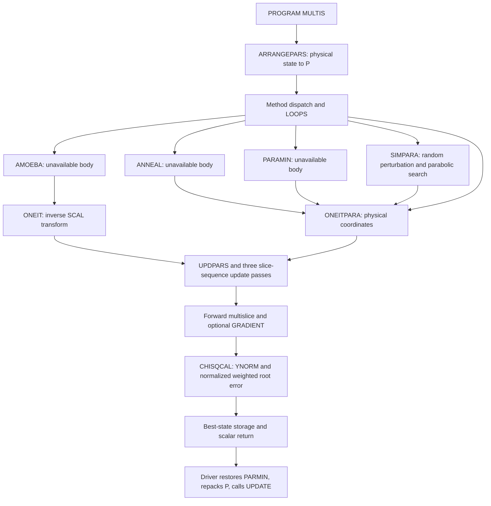

# Legacy refinement architecture audit

## Evidence and limits

This is a static audit, not an optimizer implementation or executable-equivalence
claim. Readable executable statements take precedence over names and comments;
call sites and real inputs corroborate them. private predecessor implementation is only the
[related-version declaration reference](source_provenance.md). No fixed legacy
capacity or exact COMMON layout should become a Python design constraint.

| File and lines | Actual readable role |
| --- | --- |
| private predecessor implementation| PROGRAM MULTIS: input, method dispatch, repetitions, output |
| private predecessor implementation| scan masks, IREF, structure-factor masks, method/control/vector records |
| private predecessor implementation| optimizer sequencing and final parameter output |
| private predecessor implementation| ARRANGEPARS: pack active physical parameters |
| private predecessor implementation| ONEIT: scaled-coordinate objective callback |
| private predecessor implementation| CHISQCAL: shared objective |
| private predecessor implementation| UPDPARS: unpack parameters and update derived physical state |
| private predecessor implementation| ONEITPARA: physical-coordinate objective callback |
| private predecessor implementation| SIMPARA: stochastic simultaneous parabolic optimizer |
| private predecessor implementation| separate gas-atom randomization in SFMAP |

All `.f` files were classified by content. private predecessor implementation, private predecessor implementation, private predecessor implementation,
private predecessor implementation, private predecessor implementation, private predecessor implementation and private predecessor implementation begin with ELF magic, not Fortran
text. There is no readable AMOEBA optimizer definition: private predecessor implementation defines
ONEIT instead. private predecessor implementation contains FFT source; private predecessor implementation contains ATOMICSCATFACT.
No readable RANDNUMGEN, RANDO, NRANDO or URANDO definition was found.
The supplied Makefile is also an ELF artifact, so it cannot establish the
historical build/link selection. Binary symbols or filenames do not recover
algorithm bodies. References below are relative to private predecessor sources unless noted.

## Call graph and routine roles



Arrows out of unavailable optimizers mean **callbacks passed by the driver**,
not an audited internal invocation count or policy. PROGRAM MULTIS drives the
workflow; ONEITPARA is not a top-level driver or parallel scheduler.
UPDPARS and ARRANGEPARS perform mapping; UPDATE is an unavailable utility whose
side effects cannot be reconstructed. CHISQCAL is a scalar objective utility.

## Driver inputs, sequencing and restarts

private predecessor implementationreads METHOD, PARAOPT, LOUD; LOOPS; MAXFSIMP; MAXFPARA;
FTOL; CHIMIN; MAXTEMP; MINTEMP; COOLRATE, in that order. MINCH=CHIMIN.
ARRANGEPARS determines NPAR before reading NPAR PLAMDA values and NPAR pairs
D1,D2. SPAR copies PLAMDA into UNCERTAINTIES. No random starting P is generated
here. Method matching tests the first four characters in all-upper or all-lower
case explicitly, not arbitrary case folding.

Each selected branch repeats the following ordered calls R=1..LOOPS:

| METHOD | Calls in each repetition | Branch / call lines |
| --- | --- | --- |
| ANNE | ANNEAL | 533-581 / 549 |
| SPAR | SIMPARA | 583-634 / 602 |
| PAAN | PARAMIN then ANNEAL | 636-739 / 666,707 |
| ANPA | ANNEAL then PARAMIN | 741-844 / 766,812 |
| SIMP | AMOEBA | 846-929 / 894-895 |
| PARA | PARAMIN | 931-993 / 959 |
| SIPA | AMOEBA then PARAMIN | 996-1133 / 1052-1053,1099 |
| PASI | PARAMIN then AMOEBA | 1136-1275 / 1170,1239-1240 |
| SIAN | AMOEBA then ANNEAL | 1278-1410 / 1329-1330,1376 |
| ANSI | ANNEAL then AMOEBA | 1413-1547 / 1441,1510-1511 |

Each stage resets CHISMIN=1E20 and evaluates ONEITPARA(P) before searching;
after searching it calls UPDPARS(PARMIN), ARRANGEPARS and UPDATE. This carries
the best physical parameters into the next stage/repetition and rebuilds the
simplex when required. It is **not proven random-restart initialization**.
Best-so-far is reset per stage, not monotonically retained as one scalar for
the entire run. SFMAP2/output calls surround these transitions.

LOOPS<=0 takes the single-evaluation branch (1548-1560). Final output restores
PARMIN and writes NFUNCEVAL, PARMIN, YNORMBEST, CHISMIN (1564-1569). There is no
unconditional final local polish, global-then-local pipeline, or fallback for
an unrecognized positive-LOOPS METHOD. Internal restarts of unavailable
optimizers are unknown.

## ANNEAL: what is and is not established

The driver calls `ANNEAL(ONEITPARA,MAXFSIMP)` and labels it annealing in output.
It supplies no explicit vector argument: P is established in shared state,
and PARMIN is consumed afterward. MAXTEMP, MINTEMP and COOLRATE are read by
the driver, but their use inside ANNEAL is unproven. The readable statements
do not establish simulated-annealing mechanics, global-search capability,
Metropolis acceptance, proposal distribution, temperature initialization or
schedule, bounds enforcement, stopping formula, internal best-state storage,
or any call to AMOEBA. Do not transfer SIMPARA's known mechanics to ANNEAL.
Only the driver's annealing designation and callback/state interface are known.

## AMOEBA: simplex interface, unavailable update algorithm

private predecessor implementationconstructs a simplex explicitly. For each active physical
starting value p, it sets `SCAL(1)=1/(D2-D1)/p`, `SCAL(2)=D1*p`, then maps
the current best value to q=(p_best-SCAL(2))*SCAL(1). Thus D1*p and D2*p map
to 0 and 1; there is no visible clipping of q to that interval. SCAL is set
outside the repetition loop and is not recomputed for each new best point.
Equal D1/D2 would divide by zero without a visible guard.

The NPAR+1 rows initially copy q; row i+1 then adds PLAMDA(i) to coordinate i.
Every vertex is evaluated with ONEIT. P(NPAR+1)=0.5 is also assigned, but the
visible vertex construction copies only 1..NPAR: no extra refined coordinate
or meaning for that slot can be inferred.

Private implementation excerpt omitted from shared documentation.

This proves simplex-based minimizer intent and a callback `REAL*8 ONEIT(PT)`
with an array argument, not Nelder-Mead reflection/expansion/contraction rules
or deterministic behavior. FTOL, MAXFSIMP and CHIMIN are passed, NUMF is printed;
the convergence equation and exact budget semantics are unavailable. The local
minimizer classification is an interface-level interpretation of a simplex
around the current best point, not verification of its missing body. Calls
are directly in the driver, standalone or in the explicit hybrids above;
there is no readable evidence of ANNEAL calling AMOEBA.

There is also a source interface concern: local SIMP is declared (2001,2000)
and YP(2000) at line 30, but the call passes 1001,1000. Without AMOEBA's dummy
array declarations, leading-dimension compatibility cannot be established.
Do not copy these capacities into Python.

## PARAMIN: minimizer interface, not parameter packing

The driver fills HIGH(i)=D1(i), LOW(i)=D2(i), then calls
`PARAMIN(LOW,HIGH,ONEITPARA,FTOL)` (e.g. 954-962). It labels this parabolic
optimization and consumes PARMIN afterward. This proves it occupies a search
stage, not the ARRANGEPARS/UPDPARS mapping role. It receives two bound-like
arrays and a physical-coordinate callback; there is no explicit starting
vector or output-vector argument. Whether LOW/HIGH are absolute limits,
relative multipliers or bracketing offsets inside PARAMIN is unresolved.
The raw reference pairs are 1.05,0.95, supporting their use as relative
factors in the *visible simplex mapping*, not proving PARAMIN's interpretation.

Coordinate-wise parabolic minimization, local/global behavior, random ordering,
AMOEBA delegation, enforcement of bounds and FTOL convergence remain unproven.
PARAOPT controls the driver's printed random/listed-order message, but PARAMIN's
actual consumption is hidden. MAXFPARA and MINCH are read/assigned yet their
stopping roles cannot be recovered from executable statements in this body.

## SIMPARA: the readable stochastic optimizer

The sole call is private predecessor implementationin SPAR:

```text
SIMPARA(ONEITPARA,MAXFSIMP,MAXTEMP,MINTEMP,COOLRATE,
        UNCERTAINTIES,P,PARMIN,NPAR,PARAOPT,NFUNCEVAL,LOUD,13)
```

private predecessor implementationdefines the arguments as GOF, MAXITS, HITEMP, LOTEMP,
COOLING, UNCERT, INVAR, OUTVAR, NPARAM, POPT, NFUNC, VERB, OUNIT. This is a
serial optimizer operating on the active physical vector, not a simulation
wrapper, parameter mapper or parallel execution path.

Executable behavior:

- 73-104: initialize SEED=0, counters, CURRENTTEMP=HITEMP, OUTVAR=INVAR,
  PERTSIZE=temperature*absolute UNCERT; evaluate C0=GOF(OUTVAR), set CBEST,
  copy CENTRAL. Continue while TOTSTEPS<=MAXITS and temperature>=LOTEMP*COOLING.
- 125-145: POPT=1 draws a permutation by repeated RANDO(SEED) selection with
  duplicate rejection; POPT=0 uses listed order. Other values leave the order
  unspecified. Exact RANDO distribution/seed mutation is unavailable.
- 169-225: construct perturbations using NRANDO(SEED,0.0,PERTSIZE). The comments
  call this normal random noise; the RNG body is missing. Improvement selects
  signs aligned with OUTVAR-CENTRAL. Other cycles alternate direction rules,
  including a rejection loop until an absolute sign-direction dot product is
  <=1.50. UNITVEC is approximately a sign vector, not a Euclidean unit vector;
  “orthogonal” comments do not establish an exactly zero dot product.
- 223-278: evaluate CENTRAL-PERTVEC and CENTRAL+PERTVEC. Fit a parabola for
  each coordinate using the same three total objective values C0,C1,C2.
  Positive curvature proposes -BB/(2*AA); other cases use a signed half-step.
  Evaluate the combined NEWVAR only if at least one parabola qualified;
  otherwise C3=1E20. This is not a sequence of independent coordinate-only
  objective evaluations.
- 286-319: accept strictly improving C1, then C2, then C3 against the updated
  CBEST; copy the corresponding vector into OUTVAR. There is **no Metropolis
  test or acceptance of a worse point** in these statements.
- 387-426: every NPARAM cycles reevaluate GOF(OUTVAR), copy CENTRAL=OUTVAR,
  zero UNITVEC via their difference, and reset CHANGEFLAG. Improvement normally
  heats by division by COOLING; otherwise multiply by COOLING. The periodic
  reset forces cooling on that cycle even if an improvement just occurred.
  Recompute PERTSIZE, set C0=CBEST. Return NFUNC=TOTSTEPS at 430.

This proves randomized exploration with parabolic proposals and temperature
adaptation. It is the only readable stochastic search component; global
optimality, a conventional global-optimizer classification or escape through
uphill acceptance is not established. Direction restarts stay at the current
best point, not a newly randomized starting vector. No other optimizer is
called by this routine. The parabolic calculation is a local proposal inside
this stochastic search, not a separately dispatched local minimizer.

Convergence is temperature/evaluation-budget based, not FTOL or CHIMIN based.
Checks occur at cycle boundaries: two mandatory evaluations, an optional third
and a periodic best reevaluation can exceed MAXITS. The actual threshold is
LOTEMP*COOLING, not simply LOTEMP. HITEMP is an initial value, not an enforced
ceiling. The comment requires 0<COOLING<1, but no executable validation enforces
it. There is no generic LOW/HIGH bound interface.

Source concerns to resolve before translation:

- UNITVEC is read at 171 before any visible initialization; SINCECHANGE can be
  read at 189 before assignment. Do not silently assume zero-initialized locals.
- NPARAM=0 would reach MOD(CYCLE,NPARAM); no explicit positive-count guard.
- The NEWVAR/NEWVAR check at 255 rejects zero as well as invalid arithmetic.
  The upper cap 10000 at 265-266 applies only within the positive-curvature
  branch; it is not a general symmetric or physically typed parameter bound.
- The callback can mutate its PT argument, shared P/PARMIN and physical state.
  INVAR and OUTVAR are the driver's P and PARMIN, also accessed by the callback.
  In particular trial callbacks can overwrite PARMIN before SIMPARA performs
  its own comparison; CBEST and CHISMIN have separate update rules (strict <
  versus <=). A future pure callback must not silently erase these effects.

## RANDNUMGEN and random utilities

There is no readable routine named RANDNUMGEN or call to it. private predecessor implementation
contains ONEITPARA, which maps a trial vector, runs diffraction and evaluates
CHISQCAL; it does not generate random starting vectors, perturb parameters or
implement random-restart search. It participates in SPAR and ANNEAL only as
the passed objective callback. RANDO and NRANDO are actual random utility
references in SIMPARA; URANDO is declared external but never called there.
Their reproducible sequences and distribution conventions are unavailable.
SFMAP separately uses RANDO for G-record x/y/starting occupancy (1840-1854);
that physical gas randomization is not an optimizer restart.

## Parameter packing, mapping and constraints

P(1:NPAR) contains only selected active parameters, with inactive physical
values retained in shared state. NPAR is rebuilt from zero by ARRANGEPARS.
The executable packing order (private predecessor implementation) is:

1. KV if KVOPT=1.
2. DEPTH in region order where TMASK=1.
3. Per region: VA then VB for CONCFLAG>0 and their masks=1; otherwise the
   masked CONSTVACCONC. GD records its index only when the region is GASTRIGGER.
4. DILATION if MASKDILATION=1.
5. If ABSORB starts literally 'YE', INELA, INELB, INELC in species order,
   each selected only for mask=1.
6. DW in region then species order, MASKDW=1.
7. Atom x then y in slice then atom order, coordinate mask=1.
8. Scan A, B, C, component 1 then 2: YY=both, NY=second, YN=first.
9. Region then selected reflection: SFFAC then ABSFAC, using the same YY/NY/YN
   convention. These are factors, not packed H/K indices or complex arrays.

The reference FOR007.DAT/STARTINGFOR007.DAT select SPAR 1 1, one loop,
MAXFSIMP=1000, MAXFPARA=1, FTOL=CHIMIN=1e-6, temperatures 100 and 1, cooling
0.9. Their 18 active values are one depth, two absorption coefficients, one
DW, six scan coordinates and eight elastic structure-factor multipliers.
FOR0013.DAT:988-989 corroborates one loop and 18 parameters; it does not
validate missing optimizer algorithms or prove this readable source built it.

ARRANGEPARS folds some signs/dilation values while packing and replaces every
|P|<1e-10 with positive 1e-10 (2289-2292). Its comment about scaling to the
same order is not a general normalization algorithm: the explicit affine
SCAL transformation belongs to the simplex path.

UPDPARS (private predecessor implementation) reverses the active ordering with COUNT, updates
physical state and derived quantities, and sometimes **mutates PT itself**.
It applies absolute values to energy/depth and several coefficients, folds
dilation>1 to its reciprocal, ties INELC=INELB for MASKINELC=-1, computes
vacancies/occupancies/applied dilation/DW, and leaves atom, scan and SF values
signed. Constant vacancy first caps >=1, then takes abs for <=0, so -2 can
become +2 before later per-slice vacancy clipping: it is not a standard
clamp of the parameter to [0,1]. COUNT mismatch merely prints a warning.
These are physical mapping constraints, not objective penalty terms.

ONEIT (private predecessor implementation) saves scaled PT, converts it with PT/SCAL(1)+SCAL(2),
performs three UPDPARS/slice-sequence passes, then restores scaled PT.
ONEITPARA (private predecessor implementationonward) takes physical PT directly and does not
perform this save/affine-restore operation. Both callbacks are stateful and
recompute physics before the objective. Mapping does not occur in SIMPARA;
mapping inside unavailable PARAMIN cannot be asserted.

Other visible mapping hazards warrant a dedicated next audit: UPDPARS tests
RTYPE(I) after the region loop within a slice loop (private predecessor implementation), where
I is no longer the slice index, and SLNO is not assigned on all paths using
it. GD is assigned conditionally by packing, but both callback best-state
blocks and final output access PARMIN(GD) unconditionally. Its valid value
for no-gas inputs is not established by readable initialization. None of
these potential historical defects is repaired or implemented in this task.

## Objective interface and best-state storage

| Search name | Passed callback | Same CHISQCAL? | Limits |
| --- | --- | --- | --- |
| ANNEAL | ONEITPARA | yes, at callback interface | internal calls unavailable |
| AMOEBA | ONEIT | yes | affine coordinates; internal simplex rules unavailable |
| PARAMIN | ONEITPARA | yes, at callback interface | search body unavailable |
| SIMPARA | GOF=ONEITPARA | yes, calls at 93,231,234,277,395 | readable search, missing RNG bodies |
| RANDNUMGEN filename | defines ONEITPARA | yes | no separate RANDNUMGEN routine |

ONEIT calls CHISQCAL at private predecessor implementationand returns CSQ at 261; ONEITPARA does so
at private predecessor implementation. Both optionally call GRADIENT first (176-177 /164-165),
then flatten BEAM with beam outer and tilt inner. The scalar remains the
[implemented normalized weighted root error](objective_function.md), including
YNORM. No optimizer-specific residual formula or visible penalty is added.
Missing optimizer bodies could use callback values in unobserved acceptance
rules; this audit does not invent those rules.

CSQ<=CHISMIN stores the best objective, PARMIN, YNORMBEST and outputs in both
callbacks (private predecessor implementationprivate predecessor implementation). ONEIT stores inverse-scaled
values; ONEITPARA copies PT. Both invoke UPDPARS/ARRANGEPARS/UPDATE during best
bookkeeping. The objective's GRADIENT preprocessing remains unreadable, so a
faithful end-to-end optimizer wrapper is not yet validated. NFUNC/TOTSTEPS in
SIMPARA is explicit; NUMF is returned by AMOEBA; total NFUNCEVAL accounting
across all other paths and UPDATE effects remain unresolved.

## Recommended Python implementation order

1. Audit and implement an explicit active-parameter specification plus
   pack/unpack transformations for a well-defined supported subset. Resolve
   GD, slice indexing, sign folding, near-zero replacement and mutation policy
   first; test round trips and source-derived physical updates. Allocate from
   NPAR, not fixed Fortran capacities.
2. Build and validate a trial-vector objective wrapper using the existing
   forward and scalar APIs, keeping physical and simplex coordinates distinct.
   Resolve GRADIENT and stateful callback behavior before claiming legacy
   end-to-end equivalence. A restricted GRADIENTOPT=0 mode must be explicit.
3. Recover original RNG and missing optimizer/build source, or obtain executable
   comparison evidence. SIMPARA is the best-supported algorithm candidate but
   its uninitialized state and callback interactions require decisions first.
   Do not substitute generic simulated annealing, SciPy Nelder-Mead or a
   guessed coordinate minimizer under a legacy-equivalence label.
4. Validate individual chosen optimizers and only then implement the documented
   METHOD/LOOPS driver and best-state bookkeeping. There is no evidence-based
   requirement to implement a global optimizer before a local one: the driver
   explicitly supports both orders and standalone stages.

No production code, public APIs or behavioral tests are added by this audit.
There is no Python optimizer metadata that warrants a static invariant test.

Validation: the complete suite passed **1357 tests in 44.96 s**, using exactly
`C:\Users\peng863\AppData\Local\miniconda3\envs\qcbed-python\python.exe`.
`git diff --check` passed. Only this document and the README audit link changed;
source, reference data, Python modules and tests were unchanged. Nothing was
staged or committed.
